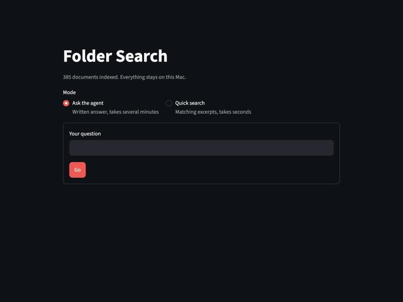

# Folder Search

Ask questions about a messy folder of documents, using RAG and an agent that runs entirely on your own machine.



## What it does

- **Quick search:** returns matching excerpts in seconds, combining search by meaning with search by keywords.
- **Ask the agent:** a local model searches and writes an answer that names its sources. It can take several minutes on modest hardware.
- **MCP server:** exposes document search and read-only Gmail tools through the Model Context Protocol.

The tools are read-only, and the document tools can only open files that are in the index.

## Models

- **LLM:** Qwen3 4B, run locally through Ollama.
- **Embeddings:** BAAI bge-small-en-v1.5, run locally through FastEmbed.

## How it works

1. **Index:** extracts text from PDF, Word, PowerPoint, text and Markdown files, splits it into chunks, and stores keywords and embeddings in a local SQLite file. Re-indexing only processes changed files.
2. **Retrieve:** merges the meaning and keyword rankings with reciprocal rank fusion.
3. **Agent (`agent.py`):** a loop of up to 10 steps where the model picks a tool (`search_documents`, `read_file`, `list_files` or `grep`) and decides whether to keep looking.
4. **Workflow (`workflow.py`):** a LangGraph graph used by the web page. It searches, judges whether the results are enough, and searches again with new wording up to three times, then writes an answer and checks its citations. It can't list or open whole files yet.
5. **MCP (`mcp_server.py`, `mcp_agent.py`):** the same tools plus `search_gmail` and `read_email`, served over stdio, with a local agent that uses them as an MCP client.

## Setup

Requires Python 3.12 and [Ollama](https://ollama.com).

```bash
python3 -m venv .venv
.venv/bin/pip install -r requirements.txt
ollama pull qwen3:4b
```

## Usage

```bash
.venv/bin/python folder_search.py index /path/to/your/folder
.venv/bin/streamlit run app.py
```

You can also use the command line:

```bash
.venv/bin/python folder_search.py search "your query"
.venv/bin/python agent.py "your question"
.venv/bin/python workflow.py "your question"
.venv/bin/python mcp_agent.py "your question"
```

To re-index automatically every 10 minutes while it runs:

```bash
.venv/bin/python folder_search.py watch /path/to/your/folder
```

### Gmail (optional)

Gmail uses Google's official API with the `gmail.readonly` scope only. Create a Google Cloud project, enable the Gmail API, and create an OAuth client of type Desktop app. Save its JSON as `~/.folder-search/google_client.json`, then sign in:

```bash
.venv/bin/python gmail_search.py login
```

Credentials stay in `~/.folder-search`, outside the repo.

## Privacy

Documents and the index stay on your machine. The index, `index.db`, holds a plain-text copy of your documents' text, so never commit or share it. The `.gitignore` here blocks everything except the listed code files.

Emails are fetched live and aren't indexed. Connecting `mcp_server.py` to a cloud-based MCP app would send whatever the tools return, including email text, to that app's provider. Email is untrusted input, so treat answers based on it with care.

## Limitations

- Scanned PDFs need OCR, which isn't supported yet.
- Spreadsheets, CSVs and images aren't indexed.
- Small local models are slow on 8 GB of memory, and can stop searching too early, so check answers against the cited files.
- PyMuPDF is AGPL or commercially licensed, so check its terms before hosting or distributing this.
